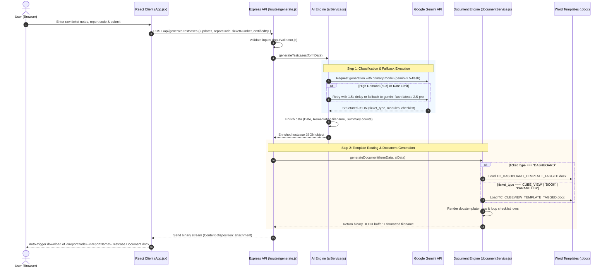
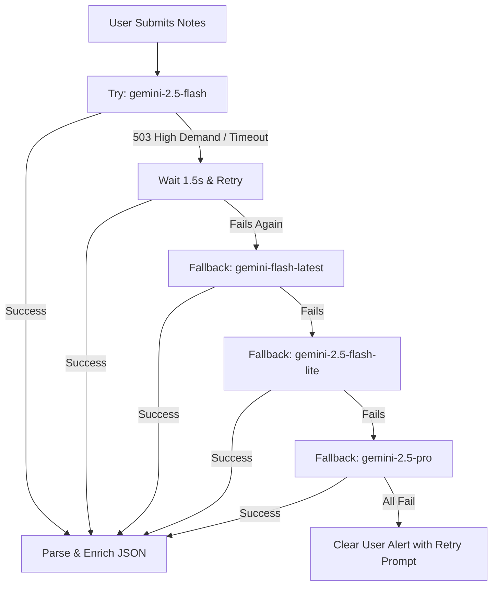

# Testcase Document Generator

> **OneStream Task Review Studio** — Automated Test Case Document Generator for OneStream changes (Cube Views, Flash Reports, Parameters, Books, and Dashboards).

🔗 **Live Application URL:** [https://tc-document-generator.onrender.com](https://tc-document-generator.onrender.com)

---

## Table of Contents
1. [Overview](#overview)
2. [Folder Structure](#folder-structure)
3. [File Purpose Reference](#file-purpose-reference)
4. [End-to-End Workflow](#end-to-end-workflow)
5. [AI Classification & Fallback Architecture](#ai-classification--fallback-architecture)
6. [Word Template System](#word-template-system)
7. [Local Setup & Development](#local-setup--development)
8. [API Reference](#api-reference)
9. [Deployment](#deployment)

---

## Overview

The **Testcase Document Generator** converts raw OneStream ticket activity notes (e.g. from ServiceNow changes, JIRA, or email handoffs) into standardized, corporate-ready Microsoft Word (`.docx`) testcase review documents.

### Key Capabilities
- **Intelligent Ticket Classification**: Automatically determines whether a ticket is a `CUBE_VIEW` (Normal, Flash, or New Build), `PARAMETER_CHANGE`, `BOOK`, or `DASHBOARD`.
- **Dynamic Template Routing**: Routes requests to the appropriate tagged Word template (`TC_DASHBOARD_TEMPLATE_TAGGED.docx` for dashboards, `TC_CUBEVIEW_TEMPLATE_TAGGED.docx` for cube views/parameters/books).
- **Mandatory Corporate Checklists**: Populates exact standard checklist questions (8 items for Cube Views, 12 items for Dashboards, etc.) with pre-filled checkboxes.
- **High-Availability AI Engine**: Features multi-model automatic failover (`gemini-2.5-flash` ➔ `gemini-flash-latest` ➔ `gemini-2.5-flash-lite` ➔ `gemini-2.5-pro`) with exponential backoff against API spikes.
- **Direct Word Download**: Delivers standardized `.docx` files formatted as `<ReportCode>-<ReportName>-Testcase Document.docx`.

---

## Folder Structure

```
daily-document-generator/
│
├── client/                                # React + Vite Frontend
│   ├── public/
│   │   └── favicon.svg                    # Application favicon
│   ├── src/
│   │   ├── services/
│   │   │   └── apiService.js              # Axios HTTP client communicating with backend
│   │   ├── App.jsx                        # Main React component (Form, progress state, download)
│   │   ├── index.css                      # OneStream corporate design system & styling
│   │   └── main.jsx                       # Vite React application entry point
│   ├── index.html                         # HTML template shell
│   ├── package.json                       # Client dependencies & scripts
│   └── vite.config.js                     # Vite build & dev proxy configuration
│
├── server/                                # Express Node.js Backend
│   ├── generated/                         # Working directory for temp files
│   ├── routes/
│   │   ├── generate.js                    # POST /api/generate-testcases route handler
│   │   └── health.js                      # GET /api/health monitoring endpoint
│   ├── services/
│   │   ├── aiService.js                   # Google Gemini integration, classification & fallbacks
│   │   └── documentService.js             # Docxtemplater Word rendering engine & template resolver
│   ├── validators/
│   │   ├── aiResponseValidator.js         # Zod schema validation for AI JSON output
│   │   ├── configValidator.js             # Startup validation for environment variables
│   │   └── inputValidator.js              # Zod validation for user form input
│   ├── .env                               # Server environment variables (local)
│   ├── .env.example                       # Template for environment variables
│   ├── create_revised_document.js         # Word OpenXML utility for building custom review docs
│   ├── index.js                           # Express application entry point & middleware
│   ├── package.json                       # Server dependencies & scripts
│   ├── server.test.js                     # Vitest automated test suite
│   ├── tag_dashboard_template.js          # Generator script that tags Dashboard DOCX templates
│   └── vitest.config.js                   # Vitest testing configuration
│
├── templates/                             # Tagged Word (.docx) Templates
│   ├── RC_TEMPLATE_TAGGED.docx            # Tagged Release Certificate template
│   ├── TC_CUBEVIEW_TEMPLATE_TAGGED.docx   # Tagged template for Cube Views, Books & Parameters
│   ├── TC_DASHBOARD_TEMPLATE_TAGGED.docx  # Tagged template for Dashboards (12-item checklist)
│   ├── TC_Cube_View_Template.docx         # Reference Cube View template
│   └── Testcase_Generation_Template.docx  # Base reference testcase template
│
├── .env.example                           # Root environment sample
├── .gitignore                             # Git ignore rules for node_modules, .env, and dist
├── package.json                           # Root monorepo scripts (build, start, dev)
├── README.md                              # Project documentation (this file)
├── run.bat                                # Windows batch runner for local startup
├── run.ps1                                # PowerShell runner for local startup
└── workflow_n8n.json                      # Reference n8n automation workflow definition
```

---

## File Purpose Reference

### Root Directory
| File | Purpose |
|---|---|
| [package.json](file:///c:/Users/siddharth.chandran/OneDrive%20-%20Quanta%20Services%20Management%20Partnership,%20L.P/Documents/Automation/daily-document-generator/package.json) | Root package defining monorepo commands (`npm run build`, `npm start`, `npm run dev`) that coordinate both client and server on Render and local machines. |
| [README.md](file:///c:/Users/siddharth.chandran/OneDrive%20-%20Quanta%20Services%20Management%20Partnership,%20L.P/Documents/Automation/daily-document-generator/README.md) | Complete reference guide containing live link, directory structure, workflow diagrams, and component details. |
| [run.bat](file:///c:/Users/siddharth.chandran/OneDrive%20-%20Quanta%20Services%20Management%20Partnership,%20L.P/Documents/Automation/daily-document-generator/run.bat) | Windows batch script to launch both frontend and backend concurrently in local development. |
| [run.ps1](file:///c:/Users/siddharth.chandran/OneDrive%20-%20Quanta%20Services%20Management%20Partnership,%20L.P/Documents/Automation/daily-document-generator/run.ps1) | PowerShell script providing automated environment checks and local server execution. |
| [workflow_n8n.json](file:///c:/Users/siddharth.chandran/OneDrive%20-%20Quanta%20Services%20Management%20Partnership,%20L.P/Documents/Automation/daily-document-generator/workflow_n8n.json) | Exported reference n8n workflow from which the exact prompt logic and JSON transformation rules were mirrored. |
| [.gitignore](file:///c:/Users/siddharth.chandran/OneDrive%20-%20Quanta%20Services%20Management%20Partnership,%20L.P/Documents/Automation/daily-document-generator/.gitignore) | Prevents committing `node_modules`, sensitive `.env` files, build output (`dist/`), and temporary docx files to Git. |

---

### Client (`/client`)
| File | Purpose |
|---|---|
| [client/index.html](file:///c:/Users/siddharth.chandran/OneDrive%20-%20Quanta%20Services%20Management%20Partnership,%20L.P/Documents/Automation/daily-document-generator/client/index.html) | Root HTML file with web fonts (`Inter`), responsive viewport tags, and metadata for Testcase Document Generator. |
| [client/vite.config.js](file:///c:/Users/siddharth.chandran/OneDrive%20-%20Quanta%20Services%20Management%20Partnership,%20L.P/Documents/Automation/daily-document-generator/client/vite.config.js) | Vite configuration defining build targets, plugins, and proxy rules forwarding `/api` calls to port `3000` during dev. |
| [client/src/main.jsx](file:///c:/Users/siddharth.chandran/OneDrive%20-%20Quanta%20Services%20Management%20Partnership,%20L.P/Documents/Automation/daily-document-generator/client/src/main.jsx) | React 18 bootstrap file that mounts `<App />` to the DOM root. |
| [client/src/App.jsx](file:///c:/Users/siddharth.chandran/OneDrive%20-%20Quanta%20Services%20Management%20Partnership,%20L.P/Documents/Automation/daily-document-generator/client/src/App.jsx) | Core frontend UI component. Handles form input (Testcase Raw Details, Report Code, Ticket Number, Certified By), validation, multi-stage animated loading feedback, error banners, and direct file download trigger. |
| [client/src/index.css](file:///c:/Users/siddharth.chandran/OneDrive%20-%20Quanta%20Services%20Management%20Partnership,%20L.P/Documents/Automation/daily-document-generator/client/src/index.css) | Custom Vanilla CSS design system styled with OneStream corporate blue palette (`#002D62`, `#0072CE`), subtle card shadows, and micro-animations. |
| [client/src/services/apiService.js](file:///c:/Users/siddharth.chandran/OneDrive%20-%20Quanta%20Services%20Management%20Partnership,%20L.P/Documents/Automation/daily-document-generator/client/src/services/apiService.js) | Axios API client configured to send multipart/JSON payloads, handle binary blob responses, extract file names from `Content-Disposition`, and trigger browser downloads. |

---

### Server (`/server`)
| File | Purpose |
|---|---|
| [server/index.js](file:///c:/Users/siddharth.chandran/OneDrive%20-%20Quanta%20Services%20Management%20Partnership,%20L.P/Documents/Automation/daily-document-generator/server/index.js) | Express entry point. Configures Helmet security headers, CORS policies, rate limiting, JSON body parsers, routes, and production static file serving from `client/dist`. |
| [server/routes/generate.js](file:///c:/Users/siddharth.chandran/OneDrive%20-%20Quanta%20Services%20Management%20Partnership,%20L.P/Documents/Automation/daily-document-generator/server/routes/generate.js) | Main API route (`POST /api/generate-testcases`). Orchestrates request validation, calls `aiService.js`, sends AI output to `documentService.js`, and streams the resulting `.docx` file buffer back to the user. |
| [server/routes/health.js](file:///c:/Users/siddharth.chandran/OneDrive%20-%20Quanta%20Services%20Management%20Partnership,%20L.P/Documents/Automation/daily-document-generator/server/routes/health.js) | Health monitoring endpoint (`GET /api/health`) used by uptime monitors and Render health checks to verify service availability. |
| [server/services/aiService.js](file:///c:/Users/siddharth.chandran/OneDrive%20-%20Quanta%20Services%20Management%20Partnership,%20L.P/Documents/Automation/daily-document-generator/server/services/aiService.js) | Core AI engine. Houses the detailed prompt instructions, ticket type classification logic, response JSON parser, date/remediation file enricher, and resilient multi-model retry/fallback handling. |
| [server/services/documentService.js](file:///c:/Users/siddharth.chandran/OneDrive%20-%20Quanta%20Services%20Management%20Partnership,%20L.P/Documents/Automation/daily-document-generator/server/services/documentService.js) | DOCX document engine. Selects the correct template based on ticket type (`TC_DASHBOARD_TEMPLATE_TAGGED.docx` vs `TC_CUBEVIEW_TEMPLATE_TAGGED.docx`), executes docxtemplater row loops, and generates binary document buffers. |
| [server/validators/inputValidator.js](file:///c:/Users/siddharth.chandran/OneDrive%20-%20Quanta%20Services%20Management%20Partnership,%20L.P/Documents/Automation/daily-document-generator/server/validators/inputValidator.js) | Zod schema ensuring incoming form data includes valid `updates`, `reportCode`, and `ticketNumber`. |
| [server/validators/aiResponseValidator.js](file:///c:/Users/siddharth.chandran/OneDrive%20-%20Quanta%20Services%20Management%20Partnership,%20L.P/Documents/Automation/daily-document-generator/server/validators/aiResponseValidator.js) | Zod schema validating that Gemini returns well-structured JSON containing required fields (`ticket_type`, `tc_cube_view`, `modules`). |
| [server/validators/configValidator.js](file:///c:/Users/siddharth.chandran/OneDrive%20-%20Quanta%20Services%20Management%20Partnership,%20L.P/Documents/Automation/daily-document-generator/server/validators/configValidator.js) | Startup validator checking that mandatory environment variables like `GEMINI_API_KEY` are defined before launching the server. |
| [server/tag_dashboard_template.js](file:///c:/Users/siddharth.chandran/OneDrive%20-%20Quanta%20Services%20Management%20Partnership,%20L.P/Documents/Automation/daily-document-generator/server/tag_dashboard_template.js) | Standalone utility script that ingests the raw reference Dashboard document and injects docxtemplater tags (`{doc_title}`, `{total_label}`, `{#checklist}{sno}`) with clean OpenXML structure. |
| [server/create_revised_document.js](file:///c:/Users/siddharth.chandran/OneDrive%20-%20Quanta%20Services%20Management%20Partnership,%20L.P/Documents/Automation/daily-document-generator/server/create_revised_document.js) | Advanced OpenXML manipulation script used for creating custom review documents and inspect OpenXML table cells. |
| [server/server.test.js](file:///c:/Users/siddharth.chandran/OneDrive%20-%20Quanta%20Services%20Management%20Partnership,%20L.P/Documents/Automation/daily-document-generator/server/server.test.js) | Automated test suite validating input rules, schema constraints, and mock generation. |

---

### Templates (`/templates`)
| File | Purpose |
|---|---|
| [templates/TC_DASHBOARD_TEMPLATE_TAGGED.docx](file:///c:/Users/siddharth.chandran/OneDrive%20-%20Quanta%20Services%20Management%20Partnership,%20L.P/Documents/Automation/daily-document-generator/templates/TC_DASHBOARD_TEMPLATE_TAGGED.docx) | Tagged Word template specialized for Dashboard tickets. Features `Total Dashboards` / `Testcases per dashboard` headers and the fixed 12-item Dashboard Updation checklist. |
| [templates/TC_CUBEVIEW_TEMPLATE_TAGGED.docx](file:///c:/Users/siddharth.chandran/OneDrive%20-%20Quanta%20Services%20Management%20Partnership,%20L.P/Documents/Automation/daily-document-generator/templates/TC_CUBEVIEW_TEMPLATE_TAGGED.docx) | Tagged Word template for Cube Views, Flash Reports, Parameters, and Books. Supports dynamic row loops and category labels. |
| [templates/RC_TEMPLATE_TAGGED.docx](file:///c:/Users/siddharth.chandran/OneDrive%20-%20Quanta%20Services%20Management%20Partnership,%20L.P/Documents/Automation/daily-document-generator/templates/RC_TEMPLATE_TAGGED.docx) | Tagged template for Release Certificate documentation. |

---

## End-to-End Workflow



### Workflow Steps Explained
1. **User Submission**: The engineer pastes ticket notes (e.g. `CHG0058275 Forecast reports in workflow (RptgGrp_Dashboard)`), specifies Report Code (e.g. `R168`), Ticket Number, and Certified By name.
2. **Input Validation**: Backend ensures non-empty, sanitized text via Zod before incurring any API overhead.
3. **AI Classification**: `aiService.js` instructs Gemini to classify the ticket:
   - `DASHBOARD`: Notes mentioning "Dashboard", "RptgGrp_Dashboard", or dashboard workspace updates.
   - `CUBE_VIEW`: Notes mentioning specific cube views (e.g., `PWRJOB_RPT_15`), column/row formatting, or margins.
   - `PARAMETER_CHANGE`: Notes regarding workflow rules or parameter bounds.
   - `BOOK`: Notes regarding `.xlBook` files or Book directories.
4. **Resilient AI Execution**: The engine queries Gemini. If Google's API returns a temporary `503 Service Unavailable`, it automatically retries with backoff and switches to backup models.
5. **Data Enrichment**: The server computes real-world data that LLMs cannot reliably predict (current date, exact remediation workbook filename `<ReportName>_Remediation_MM-DD-YYYY.xlsx`, summary checklist counts).
6. **Template Routing & XML Assembly**: `documentService.js` routes the enriched data into the matching pre-tagged template, replacing variables and repeating checklist table rows cleanly.
7. **Delivery**: The browser receives the finished document buffer and triggers an instant download with the standard filename format.

---

## AI Classification & Fallback Architecture

To guarantee 99.9% availability even during Google Cloud demand spikes, `aiService.js` implements a resilient multi-model fallback chain:



---

## Word Template System

The templates use `docxtemplater` delimiter syntax (`{variable}`, `{#loop}...{/loop}`) with validated OpenXML tags:

### Summary Table Variables
| Placeholder | Description | Example |
|---|---|---|
| `{doc_title}` | Document header | `ONESTREAM DASHBOARD TASK REVIEW CHECKLIST` |
| `{project_name}` | Project name | `Quanta - OneStream` |
| `{reviewer_name}` | Name of reviewer | `Siddharth Chandran` |
| `{review_date}` | Formatted date | `10/29/2026` |
| `{status}` | Approval state | `Approved` |
| `{total_label}` | Summary column label | `Total Dashboards` or `Total Reports` |
| `{tc_per_label}` | Summary per-item label | `Testcases per dashboard` or `Testcases per Report` |
| `{total_reports}` | Total count of reports/dashboards | `1` |
| `{tc_per_report}` | Testcases per item | `12` or `8` |
| `{total_testcase}` | Total testcase calculation | `12` |

### Checklist Table Looping
Within Table 2, rows are dynamically generated per module and checklist item:
- `{#modules}`: Iterates over each distinct report/dashboard.
- `{#checklist}{sno}`: S. No. for each checklist question (Cell 1).
- `{parameter}`: Checklist question description (Cell 2).
- `{yes_mark}`: `☑` (Cell 3).
- `{no_mark}`: `☐` (Cell 4).
- `{na_mark}{/checklist}`: `☐` (Cell 5, closes row loop).

---

## Local Setup & Development

### 1. Prerequisites
- **Node.js**: v18.0.0 or higher
- **npm**: v8.0.0 or higher
- **Google Gemini API Key**: From [Google AI Studio](https://aistudio.google.com/app/apikey)

### 2. Environment Setup
Create `server/.env` with your API credentials:
```env
PORT=3000
GEMINI_API_KEY=your_gemini_api_key_here
GEMINI_MODEL=gemini-2.5-flash
CORS_ORIGIN=http://localhost:5173
```

### 3. Installation
From the root directory:
```bash
# Install root, server, and client dependencies
npm run install:all
```

### 4. Running Locally
Run both backend and frontend concurrently:
```bash
npm run dev
```
- **Frontend**: `http://localhost:5173`
- **Backend API**: `http://localhost:3000`

---

## API Reference

### Health Check
```http
GET /api/health
```
**Response:**
```json
{
  "status": "ok",
  "timestamp": "2026-10-29T09:28:35.000Z",
  "service": "daily-document-generator-server",
  "geminiConfigured": true
}
```

### Generate Document
```http
POST /api/generate-testcases
Content-Type: application/json
```
**Request Body:**
```json
{
  "updates": "CHG0058275 Forecast reports in workflow (RptgGrp_Dashboard)",
  "reportCode": "R168",
  "ticketNumber": "CHG0058275",
  "certifiedBy": "Siddharth Chandran"
}
```
**Response:** Binary `.docx` stream with headers:
```http
Content-Type: application/vnd.openxmlformats-officedocument.wordprocessingml.document
Content-Disposition: attachment; filename="R168-RptgGrp_Dashboard-Testcase Document.docx"
```

---

## Deployment

The application is deployed on **Render** as a full-stack Web Service:
- **Build Command**: `npm run build` *(installs dependencies and builds Vite client into `client/dist`)*
- **Start Command**: `npm start` *(starts `server/index.js` which serves both API and static UI)*
- **Environment Variables**: Set `GEMINI_API_KEY` in the Render Dashboard Environment settings.
- **Production URL**: [https://tc-document-generator.onrender.com](https://tc-document-generator.onrender.com)
