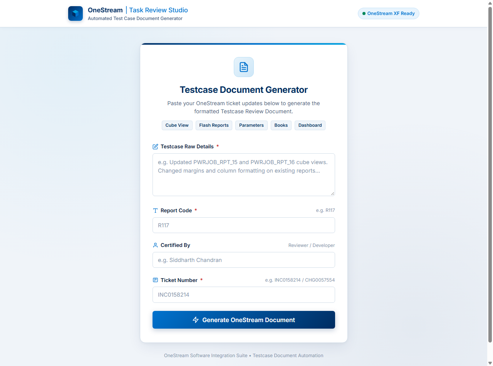
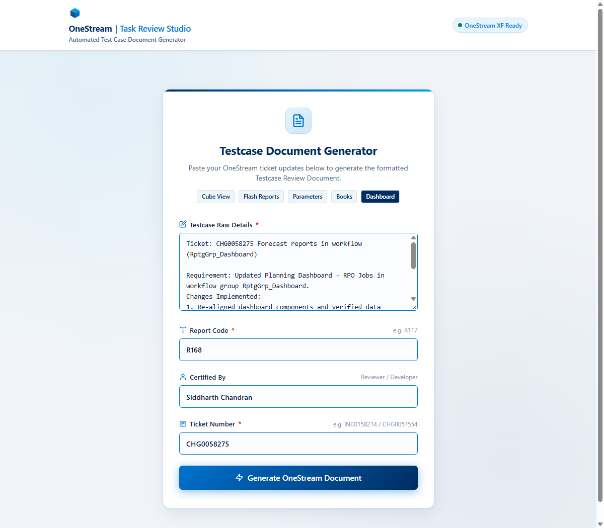
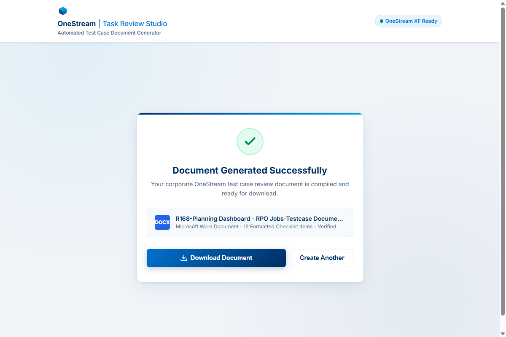

# OneStream Testcase Review Document Generator - User Help & Prompt Guide

Welcome to the **Testcase Review Document Generator** user manual. This guide explains how to use the web application to automatically transform ServiceNow tickets, daily raw logs, and change request details into standardized OneStream Testcase Review checklists.

---

## 1. Accessing the Application

- **Live URL:** `https://tc-document-generator.onrender.com`
- **Supported Browsers:** Google Chrome, Microsoft Edge, Mozilla Firefox



### Key Form Fields:
1. **Ticket Number (Optional):** E.g., `CHG0058275` or `RITM0098421`. If omitted, the AI extracts it from the prompt text or defaults to `N/A`.
2. **Reviewer Name (Optional):** Your name or reviewer initials (e.g., `Sid`, `John Doe`).
3. **Review Date (Optional):** Date of the review (defaults to current date if left blank).
4. **Daily Raw Details (Required):** The raw ticket description, developer notes, or prompt containing the OneStream artifacts and workflow changes.

---

## 2. Crafting a "Neat Prompt"

The AI engine uses keyword routing and contextual classification to determine:
- Which template to apply: **Cube View (8 items)** vs. **Dashboard (12 items)**.
- Specific artifact names to list in summary tables and header blocks.
- Pre-ticked checklist parameters based on developer activities (e.g., `_ORG` backups, data adapter SQL changes, layout adjustments).



### Standard Prompt Anatomy

A well-crafted "Neat Prompt" consists of 4 parts:
```text
[Change/Ticket Number] - [Brief Summary / Title]

Requirement:
[One-sentence explanation of the business requirement]

Workflow Context:
[Workflow group name, profile, or workspace, e.g., RptgGrp_Dashboard or Workflow Profile]

Artifacts Modified:
- [Artifact Type]: [Artifact Name 1]
- [Artifact Type]: [Artifact Name 2]

Changes Made in Detail:
1. Created backup of existing artifact as _ORG.
2. Updated [specific property / query / margin / parameter / script].
3. Verified and validated data in QA environment.
4. Ready for PROD release.
```

---

## 3. Ready-to-Use Prompt Templates

### A. Dashboard Changes (Triggers 12-Item Dashboard Checklist)
> **Key Rule:** Include the word `Dashboard` or `RptgGrp_Dashboard` to automatically route to the Dashboard checklist template.

```text
CHG0058275 - Update Planning Forecast Dashboard

Requirement:
As part of the new requirements, we updated the executive forecast dashboard layout and underlying queries. Successfully validated data in QA and releasing new version to PROD.

Workflow Context:
Forecast reports in workflow group (RptgGrp_Dashboard)

Artifacts Modified:
- Dashboard: Planning Dashboard - RPO Jobs
- Component: Grid_Forecast_Summary
- Data Adapter: DA_Forecast_JobDetails

Changes Made in Detail:
1. Created backup of Planning Dashboard as Planning_Dashboard_ORG.
2. Updated SQL query in DA_Forecast_JobDetails to include new cost center breakdown.
3. Adjusted grid margin, column width, and label alignment in Grid_Forecast_Summary.
4. Tested dashboard navigation and confirmed zero drill-down errors in QA.
```

---

### B. Cube View Changes (Triggers 8-Item Cube View Checklist)
> **Key Rule:** Explicitly name Cube Views or use Cube View identifiers (e.g., `PWRJOB_RPT_15`, `FLH_Income_Statement`).

```text
CHG0059102 - Revenue Breakdown Cube View Adjustment

Requirement:
Adjusted column layout, POV time dimension filters, and format formatting for the monthly Revenue Report.

Artifacts Modified:
- Cube View: PWRJOB_RPT_15 (Revenue Summary by Business Unit)

Changes Made in Detail:
1. Created backup of cube view as PWRJOB_RPT_15_ORG.
2. Modified Column POV definition to dynamically select current month and Prior Year actuals.
3. Updated row formatting style to display negative values in red parentheses.
4. Tested calculation performance; report rendered under 1.8 seconds in QA.
```

---

### C. Flash Reports / Books / Parameters
```text
CHG0060411 - Flash Balance Sheet & Metric Parameters

Requirement:
Updated Balance Sheet Flash Report formatting and refreshed custom date parameters for the Q4 reporting cycle.

Artifacts Modified:
- Flash Report: FLH_BalanceSheet_Summary
- Parameter: Param_ReportQuarter_End

Changes Made in Detail:
1. Created backup of Flash Report as FLH_BalanceSheet_Summary_ORG.
2. Updated parameter query string to automatically default to current fiscal close.
3. Validated visual alignment and export to PDF in QA.
```

---

## 4. Generating & Downloading Your Checklist



1. Click **Generate Checklist Document**.
2. Wait a few seconds while Google Gemini parses your prompt and dynamically builds the styled `.docx` document.
3. The success panel will display:
   - File Name (e.g., `CHG0058275_CubeView_Testcase_Review.docx` or `CHG0058275_Dashboard_Testcase_Review.docx`)
   - Document Size and Artifact Classification breakdown.
4. Click **Download Word Document (.docx)**.

---

## 5. Troubleshooting & FAQ

| Problem | Cause | Solution |
| :--- | :--- | :--- |
| **Cube View checklist generated instead of Dashboard** | The prompt lacked explicit keywords like `Dashboard` or `(RptgGrp_Dashboard)`. | Add `Dashboard` or specify `RptgGrp_Dashboard` in the prompt description. |
| **503 Service Unavailable / Spike in demand** | Google Gemini API temporary rate limit spike. | Wait 10-15 seconds and click "Generate Checklist Document" again. |
| **Reviewer name shows 'Sid' or 'N/A'** | Field left blank or not detected. | Fill the optional "Reviewer Name" field directly in the form before generating. |

